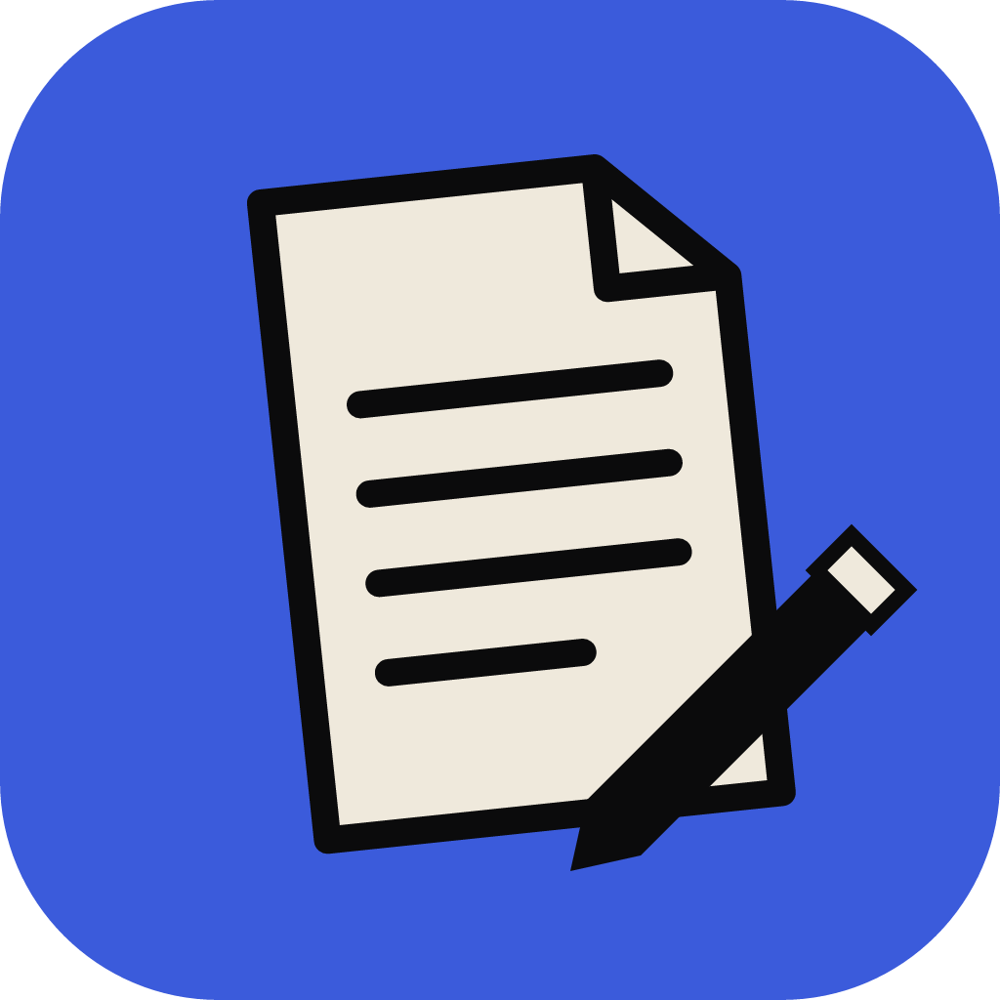

<p align="center">
  
</p>

<h1 align="center">WordCraft for Android</h1>

<p align="center">
  <b>WordCraft-android is an open-source reimplementation of the Microsoft Word Android app, created using the same Rust engine, <a href="https://github.com/storytold/wordcraft">WordCraft</a>, as the desktop app, and built with a Kotlin/Jetpack Compose UI framework.</b><br>
  Many credits to the original maintainers, <a href="https://github.com/storytold">storytold</a>.
</p>

<p align="center">
  <a href="https://github.com/artcraft-android/wordcraft-android/releases"></a>
  <a href="https://apps.obtainium.imranr.dev/redirect?r=obtainium://add/https://github.com/artcraft-android/wordcraft-android"></a>
</p>

<p align="center">
  
  
  
  
  
  
</p>

<p align="center">
  <a href="#planned-features">Planned features</a> ·
  <a href="#building-instructions">Building</a> ·
  <a href="#license">License</a>
</p>

<br>

## Planned features

WordCraft for Android is in beta.

| Area | Status |
|---|---|
| Open .docx, .docm, .dotx, .doc, .rtf, .odt and .txt; AutoSave; recent documents; Add to Home screen | ✅ |
| Mobile View and Print View, dark pages, zoom, the Headings pane, Find and Replace | ✅ |
| Home: fonts, sizes, bold, italic, underline and the rest, highlight and font colour, styles, bullets and numbering, spacing and indents | ✅ |
| Insert: pictures and camera scans, tables, shapes, text boxes, links, comments, header and footer, page numbers, equations, footnotes and endnotes | ✅ |
| Pictures, icons, shapes, charts and SmartArt: styles, effects, fill and outline, crop, wrap text, arrange, size, alt text | ✅ |
| Draw with touch: pens and highlighters | ✅ |
| Layout: margins, orientation, paper size, columns, breaks | ✅ |
| Review: spelling, comments with replies, track changes, accept and reject, word count | ✅ |
| Read Aloud with the phone's voices, dictation | ✅ |
| Tell Me: search every command by name | ✅ |
| Templates: Sample, Letter, Resume, Report; Save As, share and print | ✅ |
| Copilot and other generative AI, cloud storage, accounts, co-authoring | 🚫 WordCraft is a local app |

<sub>✅ works today · 🚧 in progress · ⬜ not started · 🚫 not planned</sub>

<br>

## Building Instructions
*One Gradle command builds the whole app: it compiles the Rust engine with [cargo-ndk](https://github.com/bbqsrc/cargo-ndk), generates the Kotlin bindings and fetches the open document fonts (Carlito, Caladea, Liberation) from pinned sources.*

* Clone this repository
* Make sure you have at least 4 GB of free disk space
* enter `apps/wordcraft-android/android` and run `./gradlew assembleRelease`, or open that folder in Android Studio and press Run.

Build time dependencies:

<details>
  <summary>required tools</summary>

  ```
      rustup (it installs the Rust release and Android targets rust-toolchain.toml names)
      cargo install cargo-ndk --version 4.1.2 --locked
      Android SDK (API 37) and NDK 29.0.14206865
      JDK 17 or newer
  ```
</details>

*Builds are only tested on Windows 11.*

<br>

## License

[MIT](LICENSE-MIT) OR [Apache-2.0](LICENSE-APACHE), at your option. WordCraft for Android is not affiliated with Microsoft;
Word is a trademark of Microsoft Corporation.

<br>

## Misc info for myself

Try to use [semantic commit](https://kapeli.com/cheat_sheets/Semantic_Commits.docset/Contents/Resources/Documents/index)
messages. Use `feat:` / `fix:` / `chore:` / `docs:` / etc.
